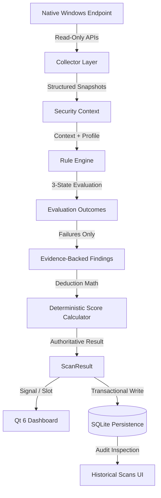

# Sentinel — Architecture Overview

Sentinel is a defensive Windows Endpoint Security Posture Analyzer implemented in C++20, Qt 6, CMake, and native Win32/COM APIs. It evaluates endpoint security posture through non-destructive, strictly read-only inspection.

---

## 1. Pipeline Architecture

---

## 2. Layer Responsibilities

### A. Collection Layer (`src/collectors/`)
- Interacts strictly with native Windows Win32, COM, and Network management interfaces:
  - `FirewallCollector`: `INetFwPolicy2` COM interfaces.
  - `DefenderCollector`: Direct registry inspection of Windows Defender security telemetry without shell command invocation.
  - `AccountCollector`: `NetUserEnum` / `NetApiBufferFree` for local security accounts.
  - `AuthenticationCollector`: `NetUserModalsGet` for system password and lockout policy baselines.
  - `EncryptionCollector`: `FSCTL_IS_VOLUME_OWNED_BY_BITLOCKER` volume device IOCTLs.
  - `UpdateCollector`: CBS servicing packages and `wuauserv` service query.
  - `SystemCollector`, `NetworkCollector`, `ServiceCollector`: IP Helper (`GetExtendedTcpTable`, `GetExtendedUdpTable`), Service Control Manager (`OpenSCManagerW`), and hardware metrics.
- Output: `CollectionResult<T>` with strict error categorization (`Success`, `PermissionDenied`, `NotSupported`, `NotFound`, `SystemError`). Collectors never assign security judgments or severity.

### B. Rule Engine (`src/rules/`)
- Evaluates raw facts in-memory using strict 3-state logic (`Pass`, `Fail`, `Unknown`).
- **Zero False-Positive Invariance**: Missing or uncollected telemetry yields `Unknown` and **never produces false security findings**.
- Findings are emitted exclusively upon definitive rule failure, backed by structured key-value `Evidence` linking to the audit source.

### C. Security Scoring (`src/core/SecurityScore.h`)
- Transparent base score of 100 with clear deductions:
  - Critical: `-25`
  - High: `-10`
  - Medium: `-5`
  - Low: `-2`
  - Info: `-0`
- Clamped cleanly between `0` and `100`.

### D. Scan Orchestration (`src/app/ScanController.h`)
- Executes native collectors sequentially on a dedicated worker thread (`QThread`) without freezing the user interface. This preserves deterministic stage ordering and partial-telemetry handling.
- Thread-safe cancellation, atomic execution guard, and stage-by-stage progress feedback.

### E. Storage & Persistence (`src/storage/`)
- **`DatabaseManager`**: Thread-safe connection manager operating on `%LOCALAPPDATA%\Sentinel\sentinel.db` with WAL mode and foreign key enforcement.
- **`DatabaseMigrator`**: Versioned transactional migrations using SQLite `PRAGMA user_version`.
- **`ScanRepository`**: Atomic transaction persistence of scans, findings, evidence, and collector diagnostics.
- **`FindingRepository`**: Normalized findings and evidence storage with foreign key cascade support.
- **`SettingsRepository`**: Non-sensitive preference persistence (no secrets or credentials).
- **`PersistenceService`**: Thread-safe singleton facade isolating database concerns from the UI and core domain model.

### F. User Interface (`src/ui/`)
- Pure model-view architecture.
- Real-time score indicator, deduction breakdown dialog, high-density findings table with filtering, finding audit inspection dialog with clipboard export, and historical audit viewer.
